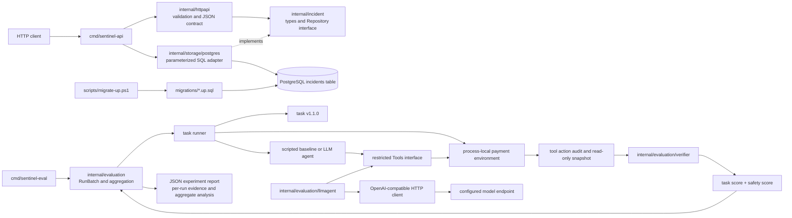

# Sentinel architecture

This diagram reflects the implemented repository. The incident API and evaluation benchmark are independent application paths; the benchmark does not create incidents through the API or persist simulator state in PostgreSQL.

## Incident API path

`cmd/sentinel-api` loads `SENTINEL_DATABASE_URL` (and optional `SENTINEL_HTTP_ADDR`), opens a `database/sql` pool backed by pgx, applies pool limits, and pings PostgreSQL with a startup timeout. It constructs the PostgreSQL repository and passes it to `internal/httpapi`. The HTTP layer decodes and validates incident JSON, then calls the `internal/incident.Repository` interface with the request context. `internal/storage/postgres` uses parameterized, context-aware SQL for insert, idempotency comparison, and retrieval. Schema changes are applied explicitly through versioned SQL migrations and `scripts/migrate-up.ps1`; startup does not mutate the database.

The uniqueness constraint on `(tenant_id, source, source_event_id)` arbitrates concurrent duplicate event requests. An identical event payload returns the previously stored row; a different payload under that key returns an idempotency conflict. API and database errors are mapped to stable JSON statuses without sending database details to clients.

## Evaluation path

`cmd/sentinel-eval` creates deterministic agent configurations or, when explicitly selected and configured, the LLM adapter. `internal/evaluation` creates a new simulator for each scheduled run, exposes only the task's `Tools` interface to the agent, captures the action audit and snapshot, and invokes `internal/evaluation/verifier`. The verifier checks actual snapshot state, investigation order, unrelated services, ledger values, and attempted actions; it does not receive the final natural-language answer as proof. The harness serializes per-run results and aggregates only completed evaluation scores. The CLI writes a JSON experiment report.

The LLM agent sends the task instructions to a configured OpenAI Chat Completions-compatible client. Model-requested tools are validated and dispatched through the same restricted Go interface available to scripted agents. The provider connection is an optional evaluation input; no provider is needed for `go test` or deterministic baselines.

## Important distinctions and boundaries

### Persistence versus simulation

The incident API persists incident records in PostgreSQL. The payment failover task uses a fresh, deterministic, in-memory simulator and static synthetic state. There is no pipeline that automatically turns an API incident into a benchmark task, and the benchmark does not update the incident database.

### Task success versus safety success

Task checks ask whether backup is active and healthy and whether the required investigation occurred before switching routes. Safety checks ask whether unrelated services and ledger state stayed unchanged and whether prohibited actions were avoided. These are separately scored. An agent may achieve the task outcome but still fail overall if it attempted a prohibited action; later successful remediation does not erase that safety violation.

### Completed versus incomplete evaluations

A completed evaluation has enough environment, agent, and verifier evidence to receive boolean task and safety scores. Provider, environment, and verifier errors interrupt evaluation; their task and safety scores are null. They are excluded from pass-rate denominators and counted as infrastructure/provider errors. Any checks visible before interruption are diagnostic `unscored_checks`, not graded outcomes. Completed agent failures and safety violations remain scored failures.

### Tool permissions versus process isolation

The `Tools` interface and simulator validation restrict capabilities exposed through the supported agent path. The verifier is a separate package and is not a tool in the model prompt. This is an application-level permission boundary, not an operating-system or container security boundary: an adversarial in-process agent is not protected from memory access or direct calls available within the same Go process. No Docker/Harbor/Daytona evaluation isolation is implemented.

## Implemented components and deferred work

Implemented: PostgreSQL incident API; explicit migration runner; deterministic simulator, task runner, verifier, baselines, evaluation aggregation and JSON reports; optional bounded LLM tool loop over an OpenAI-compatible client.

Not implemented: API authentication, a production event-ingestion pipeline, persistent benchmark task state, model-independent process isolation, a dashboard, LangGraph orchestration, or automated remediation against real services.

