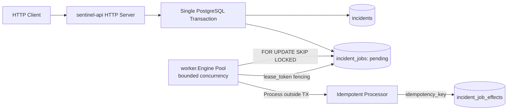

# Sentinel — Milestone 3A: Durable Asynchronous Incident Processing Engine

**Date:** 2026-11-27  
**Branch:** `portfolio-transformation`

---

## 1. Architecture Diagram

---

## 2. Job Lifecycle & State Transitions

Valid `incident_jobs.status` values:
- `pending`: Newly created or gracefully released job waiting to be claimed.
- `processing`: Claimed by a worker with an active `lease_token` and `lease_expires_at`.
- `completed`: Terminal success state (`completed_at` set).
- `failed`: Retryable failure waiting until `available_at` (exponential backoff + jitter).
- `dead_letter`: Terminal failure state after `attempts >= max_attempts` or `NonRetryableError`.

---

## 3. Database Schema & Transaction Boundaries

- **Migration:** `migrations/004_create_incident_jobs.up.sql` / `.down.sql`
  - `incident_jobs` (`UNIQUE (incident_id)` ensures 1 job per incident) with partial indexes on ready jobs (`WHERE status IN ('pending', 'failed')`), expired leases (`WHERE status = 'processing'`), and tenant-scoped inspection `(tenant_id, status, created_at DESC)`.
  - `incident_job_effects` (`idempotency_key PRIMARY KEY`) for durable external side-effect deduplication.
- **Transaction Boundaries:**
  1. **Intake (`postgres.Repository.Create`):** Single ACID transaction inserts `incidents` and `incident_jobs`. Idempotent replays return existing incident without inserting duplicate jobs.
  2. **Claim/Reclaim (`postgres.JobRepository.ClaimNext` / `ReclaimExpired`):** Short atomic CTE using `FOR UPDATE SKIP LOCKED`; transaction closes before `Processor.Process` executes.
  3. **Completion/Failure (`Complete` / `Fail` / `Release`):** Single atomic `UPDATE` fenced by `AND status = 'processing' AND lease_token = $2::uuid`.

---

## 4. Worker Concurrency, Lease Recovery & Retry Strategy

- **Bounded Concurrency:** `SENTINEL_WORKER_COUNT` (default `2`), `SENTINEL_WORKER_POLL_INTERVAL` (default `500ms`), `SENTINEL_WORKER_LEASE_DURATION` (default `30s`).
- **Lease & Fencing:** Every claim issues a fresh UUID `lease_token` and `lease_expires_at = now + leaseDuration`. If a worker stalls past `lease_expires_at`, another worker reclaims the job (`ReclaimExpired`) with a new `lease_token`. When the original stale worker attempts `Complete` or `Fail`, `RowsAffected() == 0` returns `worker.ErrLeaseLost`, preventing stale overwrites.
- **Retry Policy:** Bounded exponential backoff ($\text{base} \times 2^{\text{attempt}-1}$, capped at `MaxDelay = 5m`) with jitter (`[0.5*cap, cap]`). `MarkNonRetryable(err)` bypasses retries and transitions directly to `dead_letter`.
- **Graceful Shutdown (`cmd/sentinel-api/main.go`):**
  1. `server.Shutdown(shutdownContext)` stops accepting new HTTP incidents.
  2. `workerEngine.Stop(shutdownContext)` cancels polling, waits up to `ShutdownGrace` for in-flight jobs, and releases interrupted leases back to `pending`.
  3. `defer database.Close()` closes the pool only after workers stop.

---

## 5. At-Least-Once Execution vs. Exactly-Once Effects

PostgreSQL transactions guarantee atomic state transitions for `incident_jobs`, **not** exactly-once execution of external side effects (a worker can crash after an external HTTP/LLM call and before `Complete`). Sentinel provides **at-least-once job execution** paired with deterministic `idempotency_key` deduplication in `incident_job_effects` (and downstream external idempotency keys) so duplicate executions do not duplicate external effects.

---

## 6. Operational Metrics & Structured Logging

`worker.Metrics` exposes bounded-cardinality atomic counters (zero tenant/incident/job ID labels):
- `jobs_completed`, `jobs_failed`, `jobs_retried`, `jobs_dead_lettered`
- `jobs_processing` (active gauge), `lease_recoveries`, `stale_lease_rejections`
- `avg_processing_ms`, `processed_total`, `store_errors`
- `postgres.Repository.JobsCreated()` and `postgres.JobRepository.QueueDepth(ctx)`

Structured `log/slog` events record `worker_id`, `job_id`, `attempt`, and `available_at` without API secrets or incident payloads.

---

## 7. Verification Summary & Remaining Limitations

- **Unit & Adversarial Tests (`internal/worker/engine_test.go`):** All pass (`go test -count=1 ./...`).
- **PostgreSQL Integration Tests (`internal/storage/postgres/jobs_integration_test.go`):** Compile cleanly; skipped locally (`SENTINEL_TEST_DATABASE_URL` unset). Executed in CI (`postgres:16-alpine` + `CGO_ENABLED=1 go test -race`).
- **Race Detector:** Blocked on local Windows host (`gcc` not installed); configured in `.github/workflows/ci.yml`.
- **Remaining Limitations:** No automatic lease-heartbeat renewal for jobs exceeding `LeaseDuration`, and no dead-letter replay CLI command yet.
