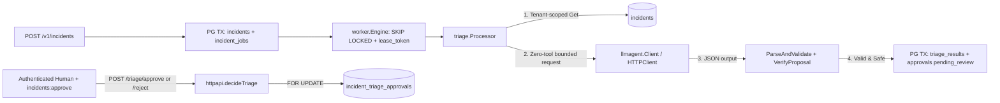

# Sentinel — Milestone 3C: LLM-Powered Incident Triage & Human Approval

**Date:** 2026-11-27

**Branch:** `portfolio-transformation`

---

## 1. Data-Flow Diagram

---

## 2. Structured Triage Contract (`ContractVersion = "1.0.0"`)

- **Classification Enum:** `availability_outage`, `latency_degradation`, `error_spike`, `dependency_failure`, `security_anomaly`, `capacity_exhaustion`, `unknown`.
- **ProposedAction Enum:** `none`, `route_failover`, `scale_service`, `rollback_deploy`, `rate_limit_caller`, `manual_investigation`.
- **Validation:** `DisallowUnknownFields()`, trailing-content check, `confidence` in `[0.0, 1.0]`, non-empty `evidence` and `recommended_steps`, and server-enforced `requires_human_approval = true`.
- **Verifier (`internal/triage/verifier.go`):** Separates `TaskPassed` and `SafetyPassed`, rejects shell/self-approval instructions, and sets `ActionExecuted = false`.

---

## 3. Approval State Machine

States in `incident_triage_approvals`: `pending_review` $\rightarrow$ `approved` | `rejected` | `expired`.
- `GET /v1/incidents/{id}/triage` (`incidents:read`) returns `TriageView` (`TriageResult` + `ApprovalRecord`).
- `POST /v1/incidents/{id}/triage/approve` & `/reject` (`incidents:approve`) lock the row with `FOR UPDATE`, check expiration, record `decided_by` (`principal.PrincipalID`), `decision_reason`, and `decided_at`, and return `409 Conflict` on duplicate or expired transitions.

---

## 4. Observability

Added bounded-cardinality Prometheus metrics in `internal/metrics/sentinel.go`:
- `sentinel_triage_requests_total`, `sentinel_triage_success_total`
- `sentinel_triage_failures_total{reason="provider_error|invalid_model_output|storage_error|incident_not_found"}`
- `sentinel_triage_provider_duration_seconds`, `sentinel_triage_invalid_responses_total`
- `sentinel_triage_approvals_pending`, `sentinel_triage_approval_decisions_total{decision="approved|rejected|expired"}`
