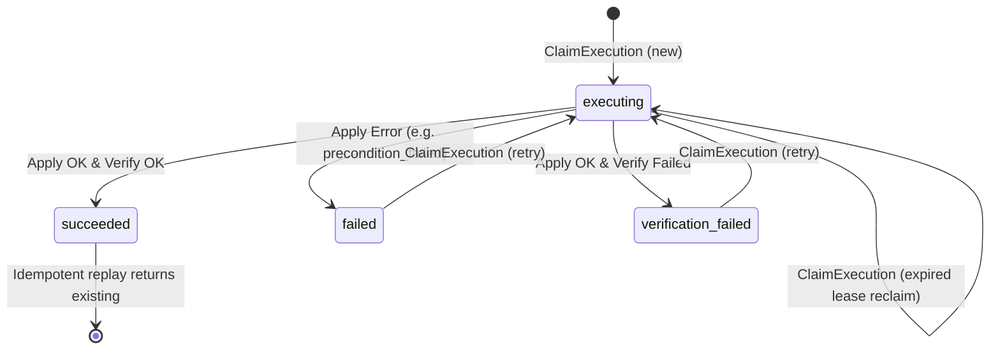

# Sentinel Controlled Remediation Architecture

**Date:** 2026-11-27

**Branch:** `portfolio-transformation`

---

## 1. Execution Flow

```mermaid
flowchart LR
    Human[Authenticated Executor<br/>incidents:execute] -->|POST /v1/incidents/{id}/remediate| API[httpapi.executeRemediation]
    API --> AuthZ[1. Validate ActionRequest<br/>2. Load Triage & Approval<br/>3. CanExecuteAction + ActionMatch]
    AuthZ -->|Short PG TX| Claim[(remediation_executions<br/>status=executing + execution_token)]
    Claim -->|TX Closed!| Sim[Simulated Infrastructure<br/>Simulator.Apply]
    Sim --> Verifier[Independent Post-Action Verifier<br/>VerifyPostAction before/after]
    Verifier -->|Fenced by execution_token| Complete[(remediation_executions<br/>succeeded / failed / verification_failed)]
```

---

## 2. Durable Execution State Machine

Valid `remediation_executions.status` values:
- `pending` / `authorized`: Initial/pre-claim states.
- `executing`: Active execution lease (`execution_token` UUID + `lease_expires_at`).
- `succeeded`: Terminal success after `Simulator.Apply` AND `VerifyPostAction` both pass.
- `failed`: Execution failed (e.g., `precondition_failed` or timeout); eligible for retry via `ClaimExecution`.
- `verification_failed`: `Apply` returned nil, but authoritative simulator state failed post-action verification; eligible for retry/investigation.



---

## 3. At-Least-Once Execution & Crash Recovery

PostgreSQL transactions fence `ClaimExecution` and `CompleteExecution` via `execution_token`, and **never** remain open during `Simulator.Apply`.

**Remaining Crash Window:** If the process crashes *after* `Simulator.Apply` mutates state and *before* `CompleteExecution` commits `succeeded`, the row remains `executing` until `lease_expires_at` passes, after which a retry reclaims the lease. Therefore Sentinel provides **at-least-once** execution with idempotent/precondition-checked actions, not distributed two-phase commit.

---

## 4. Database Schema (`migrations/006_create_remediation_executions.up.sql`)

- `remediation_executions` enforces:
  - `UNIQUE (tenant_id, idempotency_key)`
  - `UNIQUE (approval_id)`
  - `CHECK (action_type IN ('switch_payment_route_to_backup', 'disable_unhealthy_provider', 'restart_simulated_worker'))`
  - `CHECK (status IN ('pending', 'authorized', 'executing', 'succeeded', 'failed', 'verification_failed'))`
